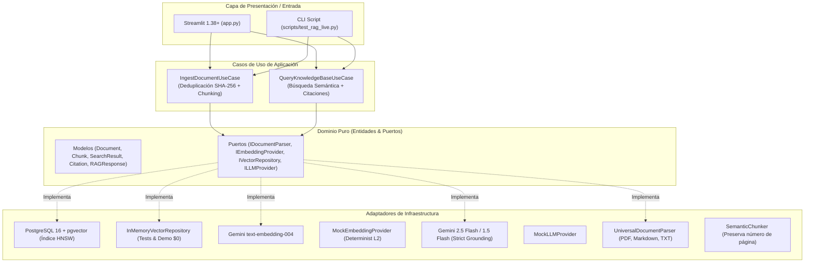

# 📚 RAG Enterprise: Búsqueda Fundamentada con Citaciones Verificables

[](https://www.python.org/)
[](https://streamlit.io/)
[](https://github.com/pgvector/pgvector)
[-green.svg)](docs/architecture.md)
[](tests/)
[](LICENSE)

Sistema completo de **Retrieval-Augmented Generation (RAG)** de grado de producción diseñado para responder sobre documentos privados (PDFs, manuales técnicos, políticas) con **citas exactas de fuentes** y **cero alucinaciones**.

Desarrollado con **Arquitectura Hexagonal pura**: el núcleo de dominio y los casos de uso son 100% independientes del framework visual (**Streamlit**), lo que permite reutilizar el mismo motor en FastAPI, Next.js o Astro sin modificar la lógica del negocio.

---

## 🏛️ Arquitectura Hexagonal

> Consulta la [Guía Completa de Arquitectura Técnica (docs/architecture.md)](docs/architecture.md) para ver diagramas de secuencia detallados, especificaciones SQL de HNSW y flujos de datos.



---

## ✨ Características Principales

1. **Citaciones Verificables de Extremo a Extremo:**
   * Cada respuesta del asistente incluye referencias explícitas `[^1]`, `[^2]`.
   * En la interfaz de Streamlit, cada cita se despliega en un acordeón interactivo que muestra el **nombre del archivo**, el **número exacto de página** y el **fragmento de texto original**.

2. **Telemetría y Métricas en Tiempo Real (KPI Cards):**
   * Cada consulta muestra tarjetas ejecutivas con **Latencia exacta (segundos)**, **Porcentaje de similitud semántica máxima**, **Cantidad de chunks analizados** y **Costo estimado por tokens (< $0.001)**.

3. **Filtro Multi-Documento (Scope de Búsqueda):**
   * Permite aislar la consulta a uno o varios documentos específicos (ej. consultar solo el contrato A o el manual B), o buscar en toda la base de conocimiento simultáneamente.

4. **Preguntas Sugeridas en 1 Clic (Starter Prompts):**
   * Botones de acción rápida para lanzar consultas clave sin escribir (puntos clave, plazos/fechas y restricciones).

5. **Exportación de Reportes de Auditoría con Citaciones:**
   * Botón de descarga para exportar toda la sesión a un archivo Markdown estructurado para auditoría legal, médica o contable.

6. **Deduplicación Automática por Hash SHA-256:**
   * Evita procesar o almacenar fragmentos duplicados si el usuario vuelve a subir el mismo archivo.

7. **Búsqueda Vectorial de Alta Velocidad con Índices HNSW:**
   * Almacenamiento en PostgreSQL 16 con la extensión oficial `pgvector`.
   * Configuración de índice HNSW (`vector_cosine_ops`) con parámetros `m = 16` y `ef_construction = 64` para consultas en menos de $10\text{ ms}$.

8. **Prevención Estricta de Alucinaciones:**
   * Si la información no está presente en el contexto recuperado, el sistema responde honestamente: *"No se encontró información relevante en los documentos indexados para responder esta pregunta"*, evitando respuestas inventadas.

9. **Doble Motor de Operación (Producción vs $0 Demo):**
   * **Modo Producción:** Conexión con PostgreSQL 16 en Docker y modelos oficiales de Google Gemini (`text-embedding-004` y `gemini-2.5-flash`).
   * **Modo Demo / Offline ($0 Costo):** Almacenamiento vectorial en memoria y modelos Mock para pruebas y tests unitarios sin conexión a internet ni consumo de saldo.

---

## 📁 Estructura del Código

```text
02-rag-system/
├── app.py                             # Frontend interactivo en Streamlit
├── docker-compose.yml                 # PostgreSQL 16 con extensión pgvector
├── requirements.txt                   # Dependencias (streamlit, pydantic, pgvector, etc.)
├── .env.example                       # Variables de configuración
├── .gitignore                         # Seguridad contra subida de PDFs y secretos
├── README.md                          # Esta documentación técnica
├── src/
│   ├── core/                          # Dominio puro desacoplado
│   │   ├── models.py                  # Entidades (Document, DocumentChunk, Citation, RAGResponse)
│   │   └── ports.py                   # Interfaces abstractas (IVectorRepository, ILLMProvider, etc.)
│   ├── infrastructure/                # Adaptadores concretos
│   │   ├── parsers/                   # UniversalDocumentParser y SemanticChunker
│   │   ├── embeddings/                # GeminiEmbeddingProvider y MockEmbeddingProvider
│   │   ├── storage/                   # PostgresVectorRepository (HNSW) e InMemoryVectorRepository
│   │   └── llm/                       # GeminiLLMProvider (Strict Grounding) y MockLLMProvider
│   └── use_cases/                     # Casos de uso de la aplicación
│       ├── ingest_document.py         # Flujo de ingestión y vectorización
│       └── query_knowledge_base.py    # Flujo de recuperación semántica y síntesis
├── scripts/
│   └── test_rag_live.py               # Script de verificación en consola con casos reales
└── tests/
    └── test_rag_pipeline.py           # Suite de tests unitarios (100% pasando)
```

---

## 🚀 Instalación y Puesta en Marcha

### 1. Clonar el repositorio y entrar a la carpeta
```bash
cd 02-rag-system
```

### 2. Instalar dependencias
```bash
pip install -r requirements.txt
```

### 3. (Opcional) Levantar PostgreSQL con pgvector en Docker
Si vas a utilizar el modo de producción con base de datos real:
```bash
docker compose up -d
```
*(Si no tienes Docker a mano, la app funciona automáticamente en Modo Demo en memoria a $0 costo).*

### 4. Configurar variables de entorno
Crea tu archivo `.env` a partir del ejemplo:
```bash
cp .env.example .env
```
Agrega tu `GEMINI_API_KEY` (gratuita en [Google AI Studio](https://aistudio.google.com/)).

---

## 🧪 Ejecutar Pruebas Automatizadas

Ejecuta la suite de verificación unitaria:
```bash
python -m unittest tests/test_rag_pipeline.py
```
*(Resultado: 4/4 tests pasando en 0.002s a costo $0).*

Para probar el flujo completo en la terminal con documentos comerciales y médicos simulados:
```bash
python scripts/test_rag_live.py
```

---

## 🖥️ Iniciar la Aplicación Visual en Streamlit

Para abrir la interfaz interactiva en tu navegador:
```bash
streamlit run app.py
```
Abrirá automáticamente [http://localhost:8501](http://localhost:8501) donde podrás:
1. Subir archivos en el panel lateral.
2. Hacer preguntas en lenguaje natural.
3. Desplegar los acordeones de citas para verificar la fuente original con número de página.

---

## 👨‍💻 Autor y Contacto

Desarrollado con dedicación por **Ezequiel** — Software Engineer & Freelance Developer.

- 🌐 **Portfolio Oficial:** [ezequielsuarez-dev.com](https://www.ezequielsuarez-dev.com/)
- 🐙 **GitHub:** [@ezequiel-dev93](https://github.com/ezequiel-dev93)
- 💼 **LinkedIn:** [in/ezequiel-suarez-dev](https://www.linkedin.com/in/ezequiel-suarez-dev/)
- ✉️ **Contacto:** [ezequielsuarez.dev@gmail.com](mailto:ezequielsuarez.dev@gmail.com)
