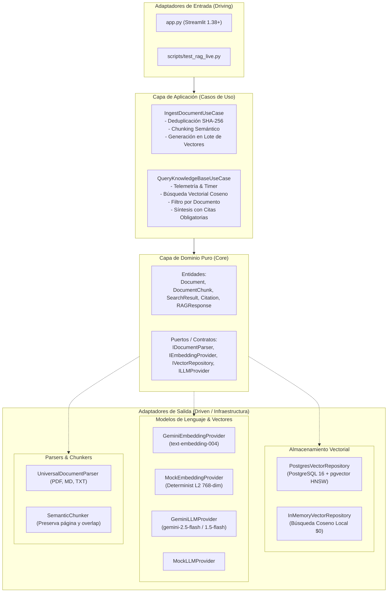
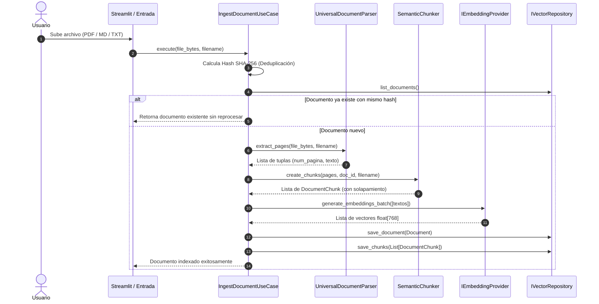
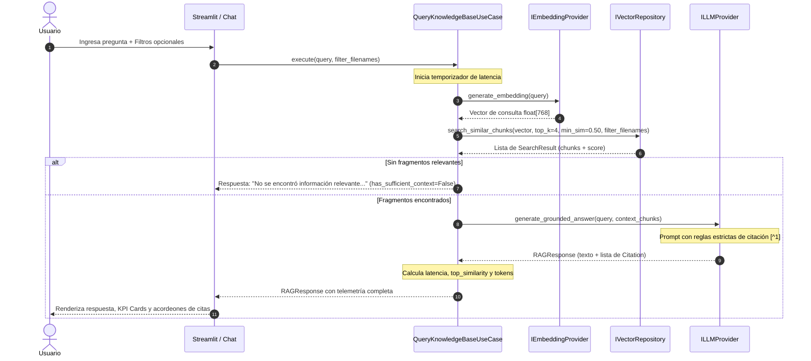

# 🏛️ Especificación de Arquitectura: Sistema RAG Enterprise

> Documento técnico de diseño arquitectónico, decisiones de ingeniería y flujo de datos para el sistema de **Retrieval-Augmented Generation (RAG)** con citaciones verificables.

---

## 📌 1. Principios de Diseño

El sistema está diseñado bajo los principios de **Clean Architecture** y **Arquitectura Hexagonal (Ports & Adapters)**:

1. **Independencia de Frameworks Visuales:**
   * La interfaz de usuario (**Streamlit**) es tratada como un **Adaptador de Entrada (Driving Adapter)**.
   * La lógica de negocio vive en `use_cases/` y `core/` sin referencias a `streamlit`.
   * Esto permite conectar el mismo núcleo a una API REST (FastAPI) o un worker en segundo plano sin modificar una sola línea del motor RAG.

2. **Aislamiento de Proveedores Externos:**
   * La base de datos vectorial (`IVectorRepository`), el generador de embeddings (`IEmbeddingProvider`) y el modelo LLM (`ILLMProvider`) son **Puertos (Interfaces Abstractas)**.
   * Se proveen adaptadores reales (PostgreSQL `pgvector`, Google Gemini) y adaptadores Mock en memoria para garantizar ejecución offline a costo $0.

---

## 🏗️ 2. Diagrama de Capas y Componentes



---

## 🔄 3. Ciclo de Vida de los Datos

### 3.1. Flujo de Ingesta y Vectorización



### 3.2. Flujo de Búsqueda y Generación Fundamentada



---

## 🗄️ 4. Modelo de Datos y PostgreSQL `pgvector`

### 4.1. Tablas en PostgreSQL 16

```sql
-- Extensión vectorial
CREATE EXTENSION IF NOT EXISTS vector;

-- Metadatos del documento
CREATE TABLE IF NOT EXISTS rag_documents (
    id VARCHAR(36) PRIMARY KEY,
    filename VARCHAR(255) NOT NULL,
    content_hash VARCHAR(64) NOT NULL,
    total_pages INTEGER DEFAULT 1,
    total_chunks INTEGER DEFAULT 0,
    created_at TIMESTAMP WITH TIME ZONE DEFAULT CURRENT_TIMESTAMP
);

-- Fragmentos y vectores embebidos
CREATE TABLE IF NOT EXISTS rag_chunks (
    id VARCHAR(36) PRIMARY KEY,
    document_id VARCHAR(36) REFERENCES rag_documents(id) ON DELETE CASCADE,
    document_name VARCHAR(255) NOT NULL,
    chunk_index INTEGER NOT NULL,
    page_number INTEGER DEFAULT 1,
    content TEXT NOT NULL,
    embedding vector(768)
);
```

### 4.2. Indexación Vectorial HNSW

Para garantizar búsquedas en menos de $10\text{ ms}$ sin escaneo secuencial lineal:

```sql
CREATE INDEX IF NOT EXISTS idx_rag_chunks_hnsw 
ON rag_chunks 
USING hnsw (embedding vector_cosine_ops)
WITH (m = 16, ef_construction = 64);
```

* **`vector_cosine_ops`:** Búsqueda basada en distancia de coseno ($1 - \text{similitud}$).
* **`m = 16`:** Cantidad de conexiones bidireccionales por nodo en el grafo HNSW.
* **`ef_construction = 64`:** Tamaño de la lista dinámica de candidatos evaluados durante la construcción del índice.

---

## 🛡️ 5. Mecanismo Anti-Alucinación

La prevención de alucinaciones se implementa en dos niveles:

1. **Filtro de Similitud Mínima en Base Vectorial:**
   * Si la similitud de coseno del fragmento más cercano es inferior al umbral ($\text{sim} < 0.50$), la consulta es rechazada antes de llamar al LLM, ahorrando costos de API y evitando inyectar ruido.
2. **System Prompt de Fundamentación Estricta:**
   * El LLM recibe la instrucción explícita de responder únicamente con hechos comprobables del contexto provisto.
   * La sintaxis `[^n]` vincula cada dato a un `DocumentChunk` específico, permitiendo auditoría humana directa sobre el texto original.
